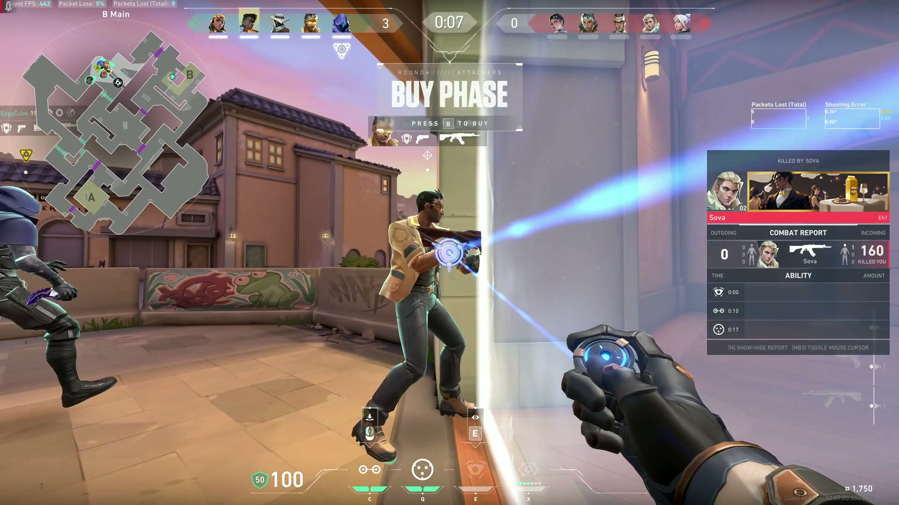
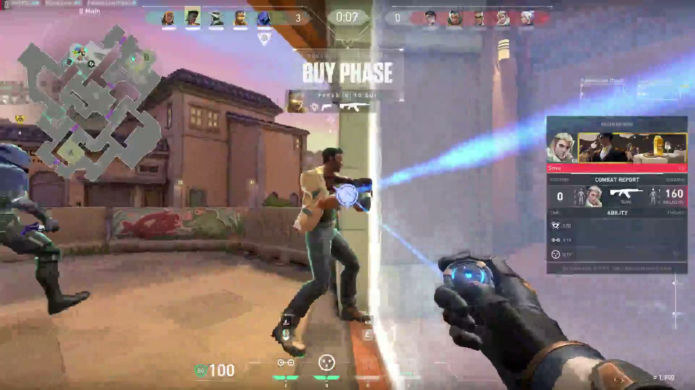
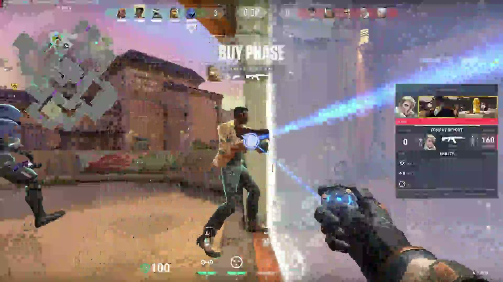
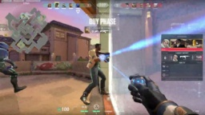
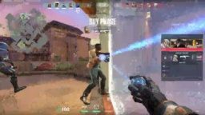

# game-frame-classifier

CNN that maps a single gameplay frame to a game label (or **unknown**). Target games: Valorant, League of Legends, CS2, Minecraft, Overwatch 2, Marvel Rivals. Aimed at clip libraries and long VODs: auto-tag by game, or report % time per title, without forcing every frame into a title.

Menus and HUD stay in the data (they are still gameplay). Non-game junk (lobby, desktop, and similar) is out of scope for the game classes and may be dropped in cleaning and/or labeled **unknown** at inference.

## The trained model

Most of this repo is data tooling (extract, clean, quality tiers, splits). The **trained model** itself is a single-frame image classifier:

| | |
|---|---|
| **Input** | One gameplay still (RGB frame) |
| **Output** | One of **seven** labels: the six games above, or **unknown** |

**Why unknown:** auto-tagging and VOD breakdowns should not invent a game when the frame is a different title, desktop chrome, or just ambiguous. Unknown frames can be skipped or bucketed when I aggregate clip-level tags.

This is **not** a video sequence model. For clip auto-tagging or “% time per game” on a VOD, I sample frames, run this same classifier on each, then aggregate (unknown does not count as a game).

## Pipeline

How I turn raw clips into train/eval data (and eventually train the model above). Clips are the source of truth; frames are derived.

Status: [pipeline status](docs/pipeline-status.md).

## Going deeper

Places I didn’t take the first convenient approach. Split into **across all games** (method choices) and **per-game special considerations** (what can confound a title, and what I actually did about it).

### Across all games

#### Quality levels

**Decision**

- **On disk / friends / eval:** keep **full** and **low (CRF 45)** stills.
- **Train:** pick **full or low at random per example** (not both). The model-size gap is small enough that 2× data is not worth it.
- **Eval:** report full and low separately.
- **Method:** re-encode the **source video** at CRF, then extract and downscale to 256×144 (not CRF on tiny JPEGs).

**Why this shape:** at model input size, even a harsh encode barely moves the pixels. On the Valorant still below, CRF 45 is only **3.5%** mean absolute difference vs full at 256×144 (`Δ = mean(|diff|) / 255`). 1080p looks much worse; the CNN never sees that. One hard degraded setting is enough. **Medium (CRF 38)** appears in the tables only as a reference so that gap is visible.

**Alternatives rejected**

- Still-frame JPEG CRF (mush, not real stream damage)
- No quality tiers at all
- A full / medium / low **ops** ladder (too little functional difference after downscale)

More detail: [quality-encoder.md](docs/roadmap/tools/quality-encoder.md).

Same timestamp · buy-phase barrier (Valorant). Top: docs view. Bottom: **256×144** (classifier input).

**1080p**

| Full | Medium (CRF 38, ref) | Low (CRF 45, used) |
|:---:|:---:|:---:|
|  |  |  |
| Δ vs full **0%** | **2.9%** | **4.9%** |

**256×144**

| Full | Medium (CRF 38, ref) | Low (CRF 45, used) |
|:---:|:---:|:---:|
|  |  |  |
| Δ vs full **0%** | **1.8%** | **3.5%** |

#### Leak-free splits

Split by **video/session**, not by frame, so near-duplicate frames from the same clip cannot leak across train and test.

#### What counts as a frame

Keep menus and HUD (still gameplay). Filter lobby / desktop / facecam-heavy separately; that is not the same as “anything with a UI.”

#### Baseline before CNN

Colour histogram + logistic regression first, then a small CNN, so I can see what spatial / HUD structure actually adds.

### Per-game special considerations

Game identity is not only “the art style.” Many cues are **user- or settings-specific**. If training data mostly shares one setup, the model can overweight those pixels and fail when settings differ. For each game I track **overfit risk** vs **what I actually did** (including “not yet”).

#### Valorant

| Factor | May affect the model | What I did |
|---|---|---|
| Enemy outline / highlight color (incl. color-blind modes) | Overfit to one outline color; other colors look “less Valorant” | Not diversified yet; mostly my settings in personal clips |
| Corner FPS / net / shooting-error graphs | Overfit to my recorder overlay habit; clips without graphs (or different layouts) look different | Often on in my captures; not stripped; need other sources without them |
| Map overlay / scoreboard / buy menu open | Large UI depends on what the player toggles; easy to overfit to “menu-heavy” frames from one person | Kept as valid gameplay (cross-game rule); must mix open vs closed UI across sources |
| Crosshairs, HUD scale, agents, skins | Overfit to my crosshair / agents / cosmetics instead of stable game chrome | Left in; no normalization; rely on more players / sources later |
| In-game graphics quality | Overfit to one softness / FX level before CRF tiers | Not locked; need clips from other graphics presets when possible |

Other titles get the same two-column treatment when I add clips for them.

## Docs

- [Docs index](docs/INDEX.md)
- [Pipeline status](docs/pipeline-status.md) (done vs missing)
- [Pipeline timing](docs/pipeline-timing.md) (extract wall-time rates)
- [Data layout](docs/data-layout.md) (`data/raw/<Game>/<source>/...`)
- [Project roadmap](docs/roadmap/ROADMAP.md)
- [Design decisions](docs/design-decisions.md)
