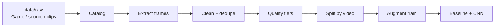

# game-frame-classifier
CNN that identifies which game a gameplay frame is from, intended use cases include auto-tagging clips and giving % breakdown of games played in longer clips or VODs.

## Quick start (frame extractor)

```bash
pip install -e ".[dev]"
gfc-catalog-clips                  # data/raw → data/manifests/clips.csv
gfc-extract-frames path\to\clip.mp4 -o data/frames/my_clip --game Valorant
gfc-clean-frames data/frames/my_clip/frames_manifest.csv -o data/frames/my_clip_cleaned
gfc-encode-quality data/frames/my_clip_cleaned/frames_manifest.csv -o data/frames/my_clip_quality
# audit pipeline:
gfc-extract-frames path\to\clip.mp4 -o data/frames/my_clip --game Valorant --debug
gfc-clean-frames data/frames/my_clip/frames_manifest.csv -o data/frames/my_clip_cleaned --debug
pytest -m "not personal"   # CI-safe
pytest -m personal         # local clip / GFC_TEST_VIDEO smokes
```

Tools are chained by **manifests** (catalog → extract → clean → quality). A batch runner over the catalog is still TODO.

## Docs
- [Docs index](docs/INDEX.md)
- [Pipeline status](docs/pipeline-status.md) — what’s done vs missing for auto-processing raws
- [Data layout](docs/data-layout.md) — where to put clips (`data/raw/<Game>/<source>/...`)
- [Project roadmap](docs/roadmap/ROADMAP.md) — stages, tools, progress plan
- [Design decisions](docs/design-decisions.md) — incremental adopt/reject log

## Data pipeline

Target flow (clips are the source of truth; frames are derived):



Build progress for each step: [pipeline status](docs/pipeline-status.md).
