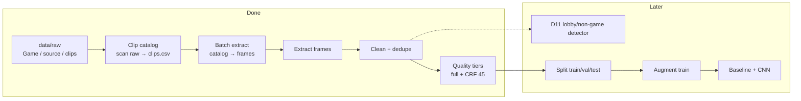

# Pipeline status

What’s built vs missing for turning `data/raw/` into train-ready frames.

**Rule of thumb:** clips in `data/raw/` are the source of truth. Frames under `data/frames/` are derived and can be reprocessed when tools or settings change.

## Diagram



## Status table

| Piece | Status | What it means |
|---|---|---|
| Catalog | **Done** | Scan `raw/` → `clips.csv` / `clips.json` with game, source, absolute path |
| Batch extract | **Done** | `gfc-batch-extract` walks the catalog → `data/frames/<Game>/<source>/<stem>/` |
| Extract | **Done** | One video → frames @ 1/5s + manifest (also used by batch) |
| Clean | **Done** | Drop black / blur / near-dupes (D11 lobby detector still planned) |
| Quality | **Done** | Video CRF (full=original / med=38 / low=45) → then extract 256×144 |
| Split / models | **Later** | Needs a finished frames set first |

## Batch extract usage

```bash
gfc-catalog-clips
gfc-batch-extract                         # all clips in data/manifests/clips.csv
gfc-batch-extract --game Valorant         # one game
gfc-batch-extract --limit 1 --max-duration 20   # smoke
gfc-batch-extract --force                 # redo existing folders (same catalog)
gfc-batch-extract --clean                 # from scratch: rescan raw, rewrite catalog,
                                          # delete stale frame folders, re-extract all
```

Skips a clip when `frames_manifest.csv` already exists (unless `--force` or `--clean`). Writes `data/frames/batch_extract_summary.json`.

`--clean` is what to use after adding/removing source videos so `clips.csv` and `data/frames/<Game>/...` match disk.

## In short

Catalog + **batch extract** + per-clip extract/clean/quality tools exist. Next for data: drop more clips under `data/raw/`, run catalog + batch extract, then clean (and later D11). Split / baseline / CNN still ahead.

## Related

- [Data layout](data-layout.md) — where clips live (`data/raw/<Game>/<source>/`)
- [Pipeline timing](pipeline-timing.md) — wall-sec per video-minute (for batch estimates)
- [Roadmap](roadmap/ROADMAP.md) — stages and tool detail pages
- [D11](design-decisions.md) — lobby/non-game filter plan
- Tool pages: [catalog](roadmap/tools/clip-catalog.md) · [extractor](roadmap/tools/frame-extractor.md) · [cleaner](roadmap/tools/frame-cleaner.md) · [quality](roadmap/tools/quality-encoder.md)
