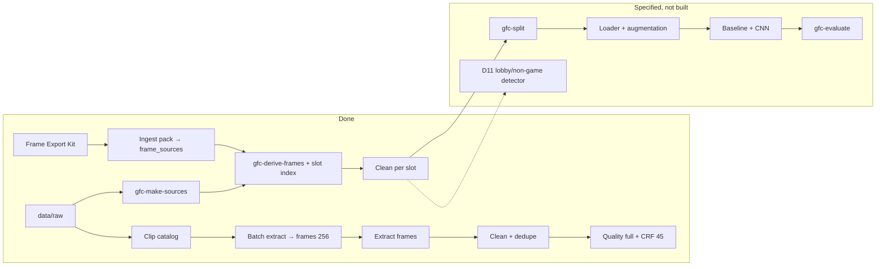

# Pipeline status

What’s built vs missing for turning `data/raw/` (and contributor packs) into train-ready frames.

**Rule of thumb:** clips in `data/raw/` are collection input. **Target** shared truth is native-res stills under `data/frame_sources/` (D26). Train-size frames under `data/frames/` are derived and can be rebuilt.

## Two paths (do not confuse)

| Path | Status | What it does |
|---|---|---|
| **Interim personal** | **Done** | `gfc-catalog-clips` → `gfc-batch-extract` → `data/frames/...` at **256×144** (plus optional `gfc-encode-quality`) |
| **Target (D26)** | **Done** | Frame Export Kit / `gfc-make-sources` → `frame_sources` → derive → clean → split → six/seven baseline and CNN → shared evaluation. Other follows `_other/<name>/<source>/` through the same path |

Batch extract is useful now; it is **not** the long-term personal path once `gfc-make-sources` lands.

## Diagram



The interim branch (catalog → batch extract → clean → quality) ends at single-clip debugging; training reads only the lower branch (D29).

## Status table

| Piece | Status | What it means |
|---|---|---|
| Catalog | **Done** | Scan `raw/` → `clips.csv` / `clips.json` with game, source, absolute path |
| Batch extract | **Done (interim)** | `gfc-batch-extract` → `data/frames/<Game>/<source>/<stem>/` at 256×144 |
| Extract | **Done** | One video → frames @ 1/5s + manifest (also used by batch) |
| Clean | **Done** | Drop black / blur / near-dupes (D11 lobby detector still planned) |
| Quality encoder | **Done** | Video CRF → extract; **ops = full + low (CRF 45)**; medium=38 docs only (D04) |
| Frame Export Kit | **Done** | Friends: clips → contributor zip (native full + crf45); v2.1.2: mixed-game folders (one pack per game from Medal-style names); GPU encode without B-frames, confirmed on an NVIDIA RTX 3060; total time printed and recorded in the pack (`timing.run_wall_s`, `estimated_s`) |
| Ingest pack | **Done** | `gfc-ingest-pack` → `data/frame_sources/` |
| `gfc-make-sources` | **Done** | Personal clips into the same `frame_sources` layout (D26) |
| Clip link downloader (`gfc-fetch-clips`) | **Done (Medal only)** | Medal clip links → `data/incoming_clips/<source>/` + `hints.csv` for the sorter; only Medal is supported and tested; other sites refused (YouTube and others possible later) |
| Clip sorter (`gfc-sort-clips`) | **Done** | Contact sheets + local page; label, disable or trash; apply copies into `data/raw/` and archives trash |
| `gfc-derive-frames` | **Done** | 256×144 frames + `clips_index` / `slots` tables (D27, D29) |
| Clean, slot mode | **Done** | One verdict per slot; dedupe across a source; quarantine list (`gfc-clean-frames --slots`) |
| `gfc-split` | **Done** | Sessions, ledger splits, tier per slot, data tables; freeze gated on D32 |
| Loader + augmentation | **Done** | `split_manifest` + `dataset`: one decode path for both models, train-only augmentation, test splits gated |
| Evaluation | **Done** | `gfc-evaluate`: classification, six-game and open-set metrics, val threshold, paired video bootstrap comparison, figures and gated test access |
| Baseline | **Done** | `gfc-train-baseline`: 16-bin RGB histograms + logistic regression, C picked on val, evaluated by `gfc-evaluate` at the end; needs at least two games in train |
| CNN | **Done** | `gfc-train-cnn`: six/seven label-set switch, four-block FrameCNN (flatten or GAP), reproducible best-val checkpoint and automatic val evaluation; GPU through `.venv-rocm` |

## Batch extract usage (interim)

```bash
gfc-catalog-clips
gfc-batch-extract                         # all clips in data/manifests/clips.csv
gfc-batch-extract --game Valorant         # one game
gfc-batch-extract --limit 1 --max-duration 20   # smoke
gfc-batch-extract --force                 # redo existing folders (same catalog)
gfc-batch-extract --clean                 # from scratch: rescan raw, rewrite catalog,
                                          # delete stale frame folders, re-extract all
```

Skips a clip when `frames_manifest.csv` already exists (unless `--force` or `--clean`). Writes `data/frames/batch_extract_summary.json`.

`--clean` is what to use after adding/removing source videos so `clips.csv` and `data/frames/<Game>/...` match disk.

Ops quality on a single clip: `gfc-encode-quality … --tiers full low` (D04). Medium remains available for docs ladders.

## In short

**Usable now:** the complete target pipeline: catalog + batch extract + clean + quality + Frame Export Kit + ingest + `gfc-make-sources` + `gfc-derive-frames` + slot-mode clean + `gfc-split` (with source groups) + loader + `gfc-evaluate` + `gfc-train-baseline` + `gfc-train-cnn`, including Other as a seventh class and the six/seven comparison (D24). **Next:** held-out test design (G1). **Later:** D11 detector.

## Related

- [Training pipeline](training-pipeline.md) — step order, files passed between tools, open decisions
- [Data layout](data-layout.md) — `raw/`, `frame_sources/`, `frames/`
- [Pipeline timing](pipeline-timing.md) — wall-sec per video-minute (batch extract estimates)
- [Handoff sizes](handoff-sizes.md) — contributor pack size/time by resolution
- [Roadmap](roadmap/ROADMAP.md) — stages and tool detail pages
- [D11](design-decisions.md) — lobby/non-game filter plan · [D26](design-decisions.md) — frame sources
- Tool pages: [catalog](roadmap/tools/clip-catalog.md) · [extractor](roadmap/tools/frame-extractor.md) · [cleaner](roadmap/tools/frame-cleaner.md) · [quality](roadmap/tools/quality-encoder.md) · [Frame Export Kit](roadmap/tools/frame-export-kit.md) · [ingest](roadmap/tools/ingest-pack.md)
