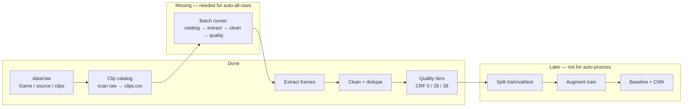

# Pipeline status

What’s built vs missing for turning `data/raw/` into train-ready frames.

**Rule of thumb:** clips in `data/raw/` are the source of truth. Frames under `data/frames/` are derived and can be reprocessed when tools or settings change.

## Diagram

## Status table

| Piece | Status | What it means |
|---|---|---|
| Catalog | **Done** | Scan `raw/` → `clips.csv` / `clips.json` with game, source, absolute path |
| Extract | **Done** | One video → frames @ 1/5s + manifest |
| Clean | **Done** | Drop black / blur / near-dupes |
| Quality | **Done** | Write full / medium / low copies (CRF 0 / 28 / 38) |
| Batch runner | **Missing** | For each catalog row: extract → clean → quality into `frames/` |
| Split / models | **Later** | Needs a finished frames set first |

## In short

Catalog + the three processing steps exist. Auto-processing all raws still needs a **batch runner** (call extract → clean → quality for every catalog row). Until then, point each tool at one path by hand (or use the catalog as the inventory list).

## Related

- [Data layout](data-layout.md) — where clips live (`data/raw/<Game>/<source>/`)
- [Roadmap](roadmap/ROADMAP.md) — stages and tool detail pages
- Tool pages: [catalog](roadmap/tools/clip-catalog.md) · [extractor](roadmap/tools/frame-extractor.md) · [cleaner](roadmap/tools/frame-cleaner.md) · [quality](roadmap/tools/quality-encoder.md)
