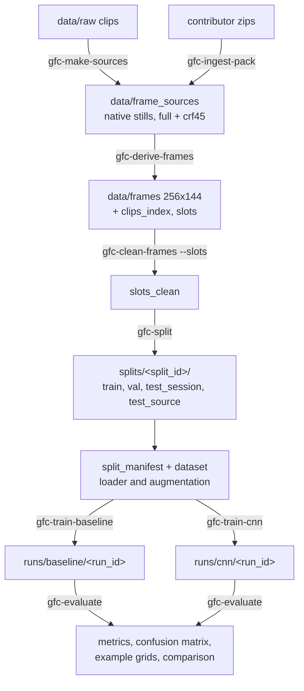

# Training pipeline

How the remaining tools fit together, from clips on disk to baseline and CNN results. Each tool has its own spec under [roadmap/tools/](roadmap/tools/); this page owns what they share: the order, the files passed between them, the conventions, and the decisions that are still open.

**Related:** [pipeline status](pipeline-status.md) · [data layout](data-layout.md) · [design decisions](design-decisions.md) · [roadmap](roadmap/ROADMAP.md)

---

## 1. Flow



| # | Step | Command | Reads | Writes | Spec | Status |
|---|---|---|---|---|---|---|
| 1a | Personal clips to frame sources | `gfc-make-sources` | `data/raw/<Game>/<source>/` | `data/frame_sources/` | [make-sources.md](roadmap/tools/make-sources.md) | implemented |
| 1b | Contributor packs to frame sources | `gfc-ingest-pack` | contributor zip | `data/frame_sources/` | [ingest-pack.md](roadmap/tools/ingest-pack.md) | implemented |
| 2 | Derive model-size frames, build the index | `gfc-derive-frames` | `data/frame_sources/` | `data/frames/`, `clips_index`, `slots` | [derive-frames.md](roadmap/tools/derive-frames.md) | implemented |
| 3 | Clean per slot | `gfc-clean-frames --slots` | `slots`, `clips_index`, `quarantine.csv` | `slots_clean` | [frame-cleaner.md](roadmap/tools/frame-cleaner.md) | implemented |
| 4 | Sessions, splits, tier assignment, data tables | `gfc-split` | `slots_clean`, `clips_index`, `config/split.json` | `splits/<split_id>/` | [dataset-splitter.md](roadmap/tools/dataset-splitter.md) | planned |
| 5 | Loader and augmentation (library, no command) | — | split manifests, `data/frames/` | tensors / arrays in memory | [dataset-loader.md](roadmap/tools/dataset-loader.md) | implemented |
| 6 | Baseline | `gfc-train-baseline` | split manifests | `runs/baseline/<run_id>/` | [baseline.md](roadmap/tools/baseline.md) | planned |
| 7 | CNN | `gfc-train-cnn` | split manifests | `runs/cnn/<run_id>/` | [cnn-trainer.md](roadmap/tools/cnn-trainer.md) | planned |
| 8 | Evaluation and report figures | `gfc-evaluate` | a run folder + split manifests | metrics, figures, comparison table | [evaluation.md](roadmap/tools/evaluation.md) | planned |

Every step is rerunnable and skips finished work, so new clips can be added at any time and pushed through steps 1 to 4 again. Existing clips never change split when that happens (section 3.5).

The interim path (`gfc-catalog-clips` → `gfc-batch-extract` → `gfc-clean-frames <manifest>`) stays available for single-clip debugging. It does not feed training: its frames have no slot ids, no paired tiers and absolute paths.

### End-to-end run

```bash
gfc-make-sources                                  # my clips
gfc-ingest-pack <zip>                             # each contributor zip
gfc-derive-frames
gfc-clean-frames --slots data/manifests/slots.csv
gfc-split                                         # draft; add --freeze once gate G1 is settled
gfc-train-baseline --split-dir data/manifests/splits/v1
gfc-train-cnn      --split-dir data/manifests/splits/v1
gfc-evaluate --compare data/runs/baseline/<run_id> data/runs/cnn/<run_id> --split val
```

---

## 2. Files passed between steps

All paths are under the data root (`data/` by default, `--data-root` on every command). Tables are CSV + JSON side by side (D20). Paths inside tables are relative to the data root with forward slashes, never absolute.

| File | Written by | Read by | One row per |
|---|---|---|---|
| `frame_sources/<Game>/<source>/<clip_key>/{full,crf45}/*.jpg` + `clip.json` | make-sources, ingest-pack | derive-frames | native image |
| `frames/<Game>/<source>/<clip_key>/{full,crf45}/*.jpg` | derive-frames | loader | 256×144 image |
| `manifests/clips_index.csv` | derive-frames | cleaner, splitter, evaluation | clip |
| `manifests/slots.csv` | derive-frames | cleaner | slot |
| `manifests/quarantine.csv` (hand-edited, optional) | — | cleaner | slot to drop |
| `manifests/slots_clean.csv` | cleaner | splitter | slot |
| `manifests/splits/<split_id>/{train,val,test_session,test_source}.csv` | splitter | loader, baseline, CNN, evaluation | used slot |
| `manifests/splits/<split_id>/ledger.csv` | splitter | splitter | clip |
| `runs/<model_type>/<run_id>/` | trainers, evaluation | evaluation | — |

Column definitions live in the spec of the tool that writes the file. A tool may add columns; it never renames or drops one that a later step reads.

---

## 3. Shared conventions

### 3.1 Identity

| Id | Form | Meaning |
|---|---|---|
| `clip_key` | `c` + first 12 hex of the clip SHA-256 | One source video, wherever it came from (D26) |
| `slot_id` | `<clip_key>:b<bucket:06d>` | One sampled moment of a clip; has one image per tier |
| `image_id` | `<slot_id>:<tier>` | One image |
| `source` | folder under `<Game>/` | One person or channel: my folder name from `data/raw/`, or `contributor_<handle>` |
| `session` | `<source>:<game>:s<NNN>` | Clips recorded close together; the unit that is split (D30) |
| `split_id` | `v1`, `v2`, … | One split policy and its ledger |
| `run_id` | `YYYYMMDD-HHMMSS` + optional `_<tag>` | One training run |

The **slot** is the unit everywhere after extraction: it is cleaned, split and counted as one item, and exactly one of its tiers is used.

### 3.2 Labels

Six classes, index order fixed by `sourcing.labels.GAMES`:

| Index | Label |
|---|---|
| 0 | `Valorant` |
| 1 | `League_of_Legends` |
| 2 | `CS2` |
| 3 | `Minecraft` |
| 4 | `Overwatch_2` |
| 5 | `Marvel_Rivals` |

Every saved model stores this list. `unknown` is not a trained class; it is produced at inference by a confidence threshold (D24) and is added in evaluation after the first results.

### 3.3 Quality tiers (D04)

Every slot is used in exactly one tier, half `full` and half `crf45`, in every split and by every tool. The rule is a pure function of the slot, so it never changes when data is added:

```text
offset = int(sha256(clip_key)[:8], 16)
tier   = "crf45" if (bucket + offset) % 2 == 1 else "full"
```

Consecutive samples of a clip alternate, so each clip is half and half to within one frame. The `crf45` tier is made by the GPU encoder at QP 51 where available and by libx264 CRF 45 otherwise; the encoder is recorded per frame and reported by evaluation (D28). The splitter writes the result into the `tier` column; nothing downstream picks a tier itself.

**Quick-mode clips** (contributors who chose the kit's quick mode) have no low tier. Every slot of such a clip is `full` and its `path_low` is empty; the splitter counts these slots per game and split, and the per-tier diagnostic skips them. Quick mode moves the overall mix above half full by the share of quick-mode footage, which `counts.csv` shows. The per-tier diagnostic (every held-out slot scored at both tiers) is part of evaluation.

### 3.4 Image contract

Model input is a 256×144 RGB JPEG made by `gfc-derive-frames` (D27). The loader checks the size and never resizes. The baseline and the CNN read the same files.

### 3.5 Stability when data is added

Clips arrive over time, so every assignment must survive a rerun:

- Tier: function of `clip_key` and `bucket` (3.3).
- Split: stored per clip in `ledger.csv`. A clip never moves to a less held-out split, and after freezing it never moves at all; new sessions are placed where a game is furthest below its target share (D31). New footage keeps growing every split, including the test splits.
- Cleaning: recomputed each run; the only cross-clip effect is near-duplicate removal inside one source, so which twin of a duplicate pair is kept can change when older footage arrives.

Each run folder records `split_id` and the SHA-256 of the split files it read, so a result can always be tied to the data snapshot it used.

### 3.6 Seeds and reproducibility

One integer `seed` per config file (`config/split.json`, `config/train_cnn.json`, `config/baseline.json`), default `360`. It seeds Python, NumPy and PyTorch. Every run folder holds the resolved config, the label list, the git commit, library versions and the split hashes.

### 3.7 Code layout and dependencies

```text
src/game_frame_classifier/
  make_sources.py        # 1a
  derive_frames.py       # 2
  frame_cleaner.py       # 3 (slot mode added)
  dataset_splitter.py    # 4
  split_manifest.py      # 5: rows, paths, image decode (NumPy + Pillow)
  dataset.py             # 5: PyTorch Dataset, transforms, loaders
  baseline.py            # 6
  model.py               # 7: FrameCNN
  train.py               # 7: training loop
  evaluation.py          # 8
config/
  recipe.json            # extraction (exists)
  split.json             # split policy
  baseline.json          # baseline settings
  train_cnn.json         # CNN settings
```

Steps 1 to 4 need only the standard library and Pillow, as today. Steps 5 to 8 use an optional dependency group:

```toml
[project.optional-dependencies]
train = ["numpy", "torch", "torchvision", "scikit-learn", "matplotlib"]
```

`pip install -e ".[dev,train]"`. Tests for steps 5 to 8 skip when these are missing. `sourcing/` stays standard-library only.

### 3.8 Held-out data discipline (D13)

Training and tuning read `train` and `val` only. The two test splits are opened by one code path, `gfc-evaluate --split test_session|test_source`, which appends a line to `data/runs/holdout_access.jsonl` each time. Model selection, thresholds and hyperparameters are chosen on `val`. Because `val` both selects and reports, val numbers are slightly optimistic for both models alike; the test splits give the unbiased number.

---

## 4. Decisions

Three kinds. IDs refer to [design-decisions.md](design-decisions.md).

### 4.1 Settled

| ID | Decision |
|---|---|
| D29 | Training reads only split manifests built from `frame_sources` through the slot index. The interim batch-extract frames are not a training input. |
| D31 | Split assignment is a per-clip ledger with greedy fill toward 70 / 15 / 15 per game; clips never move to a less held-out split. |
| D04 | Half full, half crf45 by bucket parity (3.3). |
| D14 | Per-game frames, videos, sessions and sources tables are generated by `gfc-split`, not written by hand. |
| D16b | Flatten is the primary head (keeps where HUD features are). Global average pooling is a config switch for the planned comparison. |
| D38 | One evaluation module and one run-folder layout for both models. |
| — | Stack: PyTorch + torchvision for the CNN, scikit-learn for the baseline, matplotlib for figures. |
| D23 | Hardware: local AMD RX 9070 XT through a ROCm build of PyTorch in `.venv-rocm` is primary (0.078 s per batch of 64, about 17 s per epoch at 10,000 train frames with 2 loader workers, stable over an 11-minute run; [setup](amd-gpu-setup.md)); local CPU is the fallback (1 s per batch, about 3 min per epoch at 10,000 train frames), Colab the last resort; see [CNN trainer](roadmap/tools/cnn-trainer.md#hardware). Revisit if the GPU environment breaks after a driver or ROCm update, or the trainer's GPU smoke run disagrees with the CPU run. |
| — | The baseline uses the same 256×144 files, splits and tiers as the CNN. |

### 4.2 Working defaults (cheap to change, revisit after first results)

Each is a config value or a small code switch. Changing one means rerunning a step, not rewriting anything.

| ID | Default now | Main alternative | Revisit when |
|---|---|---|---|
| D13 | Strict: test splits untouched until the final evaluation; report development numbers on `val` | Allow one logged look at `test_session` for the progress report | Writing the progress report |
| D15 | Single-stream CNN | Two-stream with HUD crops from native stills, as primary or as an ablation | After first CNN results on the look-alike pair |
| D16 | Conv 32-64-128-256, one FC of 256, dropout 0.5; 9,827,878 parameters | FC 128 (5,108,390), FC 512 (19,266,854), two FC layers, or GAP head (390,438) | Train vs val gap is known |
| D33 | No source cap; each source's share is reported and a warning is raised above 1/15 | Enforce the proposal's 1/15 cap, or a relaxed one; it only thins `train`, so it can be tightened later | Before writing a report's data section; again when public sources are added (D12) |
| D30 | Session = clips of one source and game whose start is within 30 min of the previous clip's end | Different gap, or one session per recording day | Session report on real data looks wrong |
| D34 | Keep every kept slot; correct imbalance with class weights | Downsample every game to the smallest class | Class counts are known |
| D35 | Online augmentation: zoom 0.85–1.15 and small shift on half the samples, colour jitter on most, no flips | Zoom-out only (never crops HUD edges); offline augmented copies | Looking at augmented samples and the val curve |
| D36 | Baseline: 16 bins per channel, standardised, logistic regression with `C` picked on val | More bins, HSV histogram | Only if the baseline needs to be a stronger bar |
| D37 | Adam, lr 1e-3, weight decay 1e-4, batch 64, up to 30 epochs, early stop on val macro-F1 (patience 6) | LR schedule, different batch size or weight decay | First training curves |

### 4.3 Gate (decide together before the step named)

One decision is hard to undo: once a held-out set has been evaluated or a number has been reported against it, redefining that set makes earlier results incomparable. The tools can be built and tested, and draft splits used for development on `train` / `val`, before it is settled. `gfc-split --freeze` and any evaluation of a test split are blocked in code until it is.

| Gate | Question | Blocks |
|---|---|---|
| **G1** (D32) | What are the held-out test sets: held-out sessions only, held-out whole sources, or both; which sources are held out per game; is the session rule right; and does the progress report show any test number? | `gfc-split --freeze`; any `test_session` / `test_source` evaluation; any reported test number |

Options and a suggestion are in [dataset-splitter.md](roadmap/tools/dataset-splitter.md#gates).

---

## 5. Where this differs from the proposal

| Proposal | Now | Why |
|---|---|---|
| Random CRF 28–40 on 30–50 % of train frames; test at CRF 0 / 28 / 38 | Two tiers on disk, full and CRF 45; every slot used once, half and half; per-tier diagnostic on held-out slots | D04, D22: at 256×144 only a harsh encode is visible; one degraded setting is enough |
| Re-encode with libx264 | Low tier from the GPU encoder (QP 51) with libx264 fallback, encoder recorded per frame | D28: speed, and real streams use these hardware encoders; accuracy is reported by encoder |
| Frames extracted straight to 256×144 | Native stills first, 256×144 derived from them | D26, D27: contributor packs and personal clips share one path |
| Fixed-interval extract | One frame per 5 s bucket chosen on real timestamps | D26: variable-frame-rate captures |
| Perceptual-hash dedupe per video | Average-hash dedupe per slot, across all clips of a source | Tiers stay paired; overlapping clips are caught |
| "Dominated by non-game content" dropped | Black, blur, near-duplicate and a hand quarantine list now; lobby detector later | D11 |
| 15+ channels per game, each ≤ 1/15 | Personal clips and contributor packs first; shares reported, cap not enforced yet | D33, D12 |
| Test = unseen streamers + held-out personal sessions | `test_source` and `test_session`; which sources are held out is open | G1 |
| Balanced 2,000–3,000 frames per game | Keep all kept slots; class weights | D34 |
| Hyperparameters tuned on validation | Same; test splits are never used for tuning | D13 |
| "Unknown" threshold and majority vote | Threshold added in evaluation after first results; majority vote stays a demo | D24, D07 |

---

## 6. Build order

| Order | Work | Needs | Exit check |
|---|---|---|---|
| 1 | `gfc-make-sources` | — | My clips appear under `frame_sources/` with the same layout as an ingested pack |
| 2 | `gfc-derive-frames` | 1 or an ingested pack | `slots.csv` rows match files on disk; every image is 256×144 |
| 3 | Cleaner slot mode | 2 | `slots_clean.csv` written; both tiers of a slot share one verdict |
| 4 | `gfc-split` | 3 | Leakage test green; rerun with added clips moves nothing |
| 5 | `split_manifest` + `dataset` | 4 | One train batch has shape `[B, 3, 144, 256]` |
| 6 | `evaluation` | 5 | Metrics and figures from a fake predictor |
| 7 | `gfc-train-baseline` | 5, 6 | Beats chance on val |
| 8 | `gfc-train-cnn` | 5, 6 | Overfits a tiny set; curves written |
| 9 | Settle G1, then `gfc-split --freeze` | real data in place | Frozen split; first reportable numbers |

Steps 1 to 8 can be finished on synthetic fixtures and the clips already on disk while more footage arrives.
